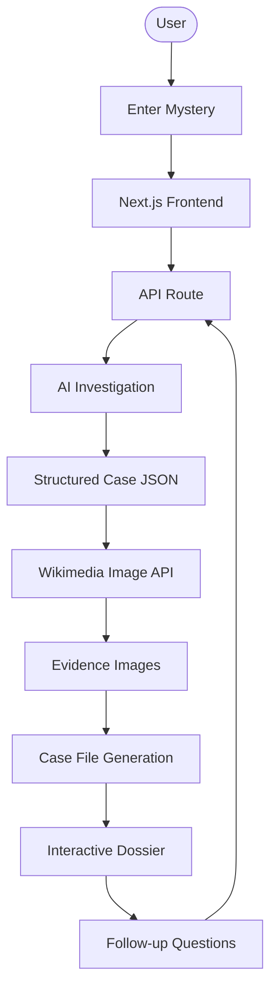
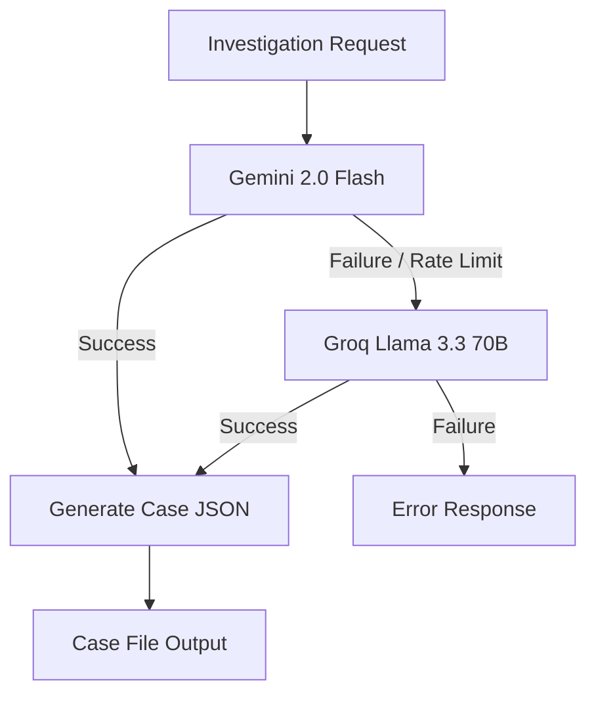
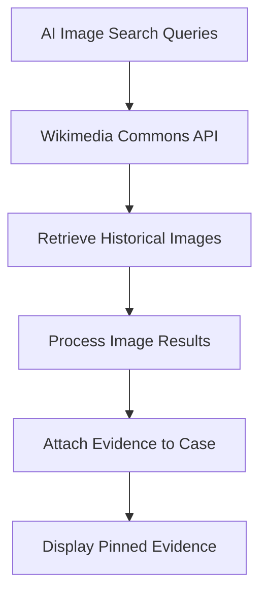

# 🔍 SHERLOX — The AI Detective Bureau

**Turn complex stories and mysteries into 3-minute classified case files.**

SHERLOX is an AI-powered investigation platform that transforms historical events, corporate controversies, and global mysteries into engaging, interactive case files.

Enter any topic and uncover the suspects, timeline, real evidence, smoking gun, and final verdict.

🌐 **Live Demo:** https://sherlox-black.vercel.app

## ✨ Features

- 🤖 AI-powered investigations using Gemini and Groq.
- 🕵️ Suspect lineup with key people and organizations.
- 📅 Chronological event timelines.
- 🔎 Smoking gun analysis and final verdict.
- 🖼️ Authentic historical images from Wikimedia Commons.
- 🎬 Cinematic detective-style interface.
- 💬 Follow-up conversations with session persistence.

## 🏗️ Architecture

### 1. Overall System Flow



### 2. AI Processing & Failover



### 3. Evidence Retrieval Flow



## 🛠️ Tech Stack

| Category | Technology |
|---|---|
| Framework | Next.js 15 |
| Language | TypeScript |
| Styling | Tailwind CSS |
| Animations | Framer Motion |
| Icons | Lucide React |
| Primary AI | Gemini 2.0 Flash |
| Backup AI | Groq – Llama 3.3 70B |
| Image API | Wikimedia Commons |
| Deployment | Vercel |

## 🚀 Getting Started

**1. Clone the repository**

```bash
git clone https://github.com/nk21-dev/SHERLOX.git
cd SHERLOX
```

**2. Install dependencies**

```bash
npm install
```

**3. Configure `.env.local`**

```env
GEMINI_API_KEY=your_gemini_api_key
GROQ_API_KEY=your_groq_api_key
```

**4. Run the application**

```bash
npm run dev
```

Open http://localhost:3000 in your browser.

## 👨‍💻 Author

**Nithish Kumar Chirukuripati**

- GitHub: [@nk21-dev](https://github.com/nk21-dev)
- LinkedIn: Nithish Kumar Chirukuripati

---

**SHERLOX — Every mystery leaves a trail. 🔍**
